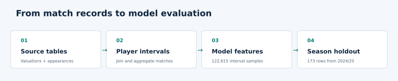
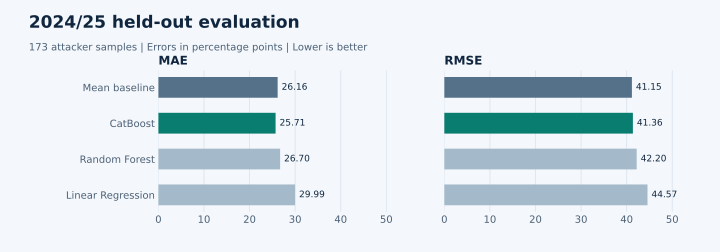

# Football Market Value Modeling

**How do you turn a football database into examples a model can learn from?**

For our Magshimim AI capstone, we designed a dataset around **one player and one valuation interval per row**. We assembled the rows from separate Transfermarkt tables for valuation updates, appearances, matches, players, and clubs. We then engineered features that describe how a player's performance changed between intervals and compared regressors on a historical test split, followed by a separate check on a later season.



## 1. Designing the dataset

| Source archive | Records |
| --- | ---: |
| Player valuation updates | 473,675 |
| Player appearances | 1,583,632 |
| Matches | 68,322 |
| Player profiles | 30,518 |

The source tables record events at different levels and on different dates. A valuation update carries a player ID and price. An appearance carries a player ID, a match ID, and individual statistics. A match carries a score from the home and away teams' perspectives. We had to decide which records belonged together and what each training example should represent.

1. **Build a timeline for each player.** Sort valuation updates by player and date. Use consecutive updates to define variable-length windows for collecting match data.
2. **Attach appearances and match context.** Within each window, collect the player's appearances, look up the matches by ID, and attribute goals for and against using the club the player represented in each match.
3. **Assemble and clean the modeling table.** Summarize playing time, goals, assists, cards, and team results into a single row. Check missing and implausible values, link clubs to domestic leagues, and retain player-level order for the next stage.
4. **Define a comparable target.** Express the valuation change as a percentage of the starting valuation so the same euro change has a different meaning for players at different price levels.

The resulting feature table had **122,615 rows across four position groups**, including **33,665 attacker rows**. The final modeling work focused on attackers, whose on-field contributions were better represented by the available statistics.

### What a percentage change means

The target is `100 × (ending valuation − starting valuation) / starting valuation`. With a positive starting valuation and a nonnegative ending valuation, a drop can approach **−100%**, and an increase can reach **several hundred percent or more**. For example, €1M → €100K is **−90%**, while €1M → €5M is **+400%**. Before filtering, the historical attacker export ranged from **−92.5% to +4,900%**. The experiments tested how to handle unusually large increases.

MAE and RMSE are measured in **percentage points of valuation change**. A prediction of +50% for an observed +100% is off by 50 percentage points.

## 2. Engineering features from player histories

We normalized totals by minutes played or appearances, then compared those rates with the same player's previous interval. This separates a change in scoring rate from a change in how often the player appeared.

| Feature family | How we built it |
| --- | --- |
| Playing time | Change in minutes per appearance from the previous interval. |
| Attacking output | Changes in goals and assists per minute. We also tested a non-penalty goals rate. |
| Team performance | Changes in goals scored and conceded per appearance, calculated from the player's club perspective. |
| Player and market context | Age, age squared and cubed, starting valuation, league rank by season, and chronological season order. |

We also tested comparisons with peers in the **same season, league, and position**. That produced a second set of features measuring how far a player's rates were above or below the group average. The later-season evaluator uses the within-player changes and excludes both the target-derived season rank and the experimental outlier classifier.

## 3. Main evaluation on the original test split

These are the test-set results reported in the capstone presentation. CatBoost reduced RMSE from **54.14 to 45.20 percentage points** compared with linear regression, a reduction of about **16.5%**.

| Model | MAE ↓ | RMSE ↓ | R² ↑ |
| --- | ---: | ---: | ---: |
| Linear regression | 31.52 | 54.14 | 0.165 |
| Random Forest | 27.91 | 47.30 | 0.363 |
| CatBoost | **26.76** | **45.20** | **0.418** |

The exact configuration behind the presentation table has yet to be verified. One historical CatBoost runner reused a split for tuning and scoring, so the reported scores should be read in that experimental context. See the [technical notes](project-audit.md#historical-experiments) for the experiment history.

## 4. Follow-up evaluation on 2024/25

We trained on **33,555 historical attacker rows** after applying the original 650% upper cutoff to the training target. We evaluated on **all 173 attacker rows from 2024/25** in the supplied export, a season absent from training. The historical-mean baseline gives every test row the same prediction.

| Model | MAE ↓ | RMSE ↓ | R² ↑ |
| --- | ---: | ---: | ---: |
| Historical mean | 26.16 | **41.15** | **−0.009** |
| Linear regression | 29.99 | 44.57 | −0.184 |
| Random Forest | 26.70 | 42.20 | −0.061 |
| CatBoost | **25.71** | 41.36 | −0.020 |



Errors are in percentage points. CatBoost had the lowest MAE, while the historical mean had the lowest RMSE and highest R². All models had negative R² on this season. The [full results](metrics.csv) include RidgeCV and LassoCV. The [technical notes](project-audit.md) explain how this follow-up differs from the original mixed-season evaluation.

## Reproduce the later-season evaluation

```bash
python -m pip install -r requirements.txt
python evaluate.py data/for_model_nov3.csv data/Attackers_new_samples_for_model.csv --historical-feature-table --test-season-order 13
```

The command starts from the prepared feature exports. It derives the percentage target and age terms, selects the later-season rows, and writes the model metrics. The [technical notes](project-audit.md) map the original notebooks and intermediate files that produced the feature table and explain how the match window relates to the prediction time.

## Authors

**Ofir Mana** and **Noam Gamliel** completed this Magshimim AI capstone together as a two-person team. They jointly developed the dataset, designed the modeling experiments, and evaluated the results.
